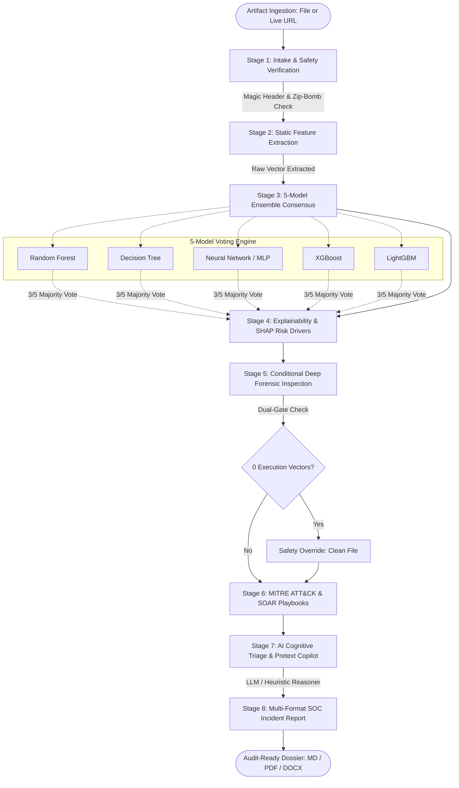

<div align="center">

# 🛡️ ExplainPhish

### Autonomous Agentic Phishing Triage & Explainable SOC Workstation

[](https://www.python.org/)
[](https://fastapi.tiangolo.com)
[](https://langchain-ai.github.io/langgraph/)
[](https://shap.readthedocs.io/)
[](tests/)
[](Dockerfile)
[](LICENSE)

*An explainable, multi-agent cybersecurity triage workstation combining passive static extraction, a 5-model machine learning ensemble, SHAP risk attribution, dual-gate deterministic forensic verification, and an LLM-powered cognitive copilot.*

[🚀 Live Demo](#getting-started) • [📖 Documentation](#table-of-contents) • [🐞 Report Issue](https://github.com/ChaiWork/ExplainPhish/issues) • [✨ Request Feature](https://github.com/ChaiWork/ExplainPhish/issues)

</div>

---

## Table of Contents

- [About](#about)
- [Features](#features)
- [Tech Stack](#tech-stack)
- [Architecture](#architecture)
- [Project Structure](#project-structure)
- [Getting Started](#getting-started)
- [Configuration](#configuration)
- [Security](#security)
- [How to Contribute?](#how-to-contribute)
- [What's Next?](#whats-next)
- [License](#license)
- [Acknowledgements](#acknowledgements)
- [Authors & Team](#authors--team)

---

## About

Modern phishing attacks distribute malicious lures through HTML credential-harvesting pages, live deceptive URLs, PDFs containing active `/Launch` actions, Excel spreadsheets with hidden VBA macros, and Word documents using remote template injection.

Security Operations Centres (SOCs) face three compounding bottlenecks:
1. **Alert Fatigue:** SOC analysts are overwhelmed with hundreds of ambiguous alerts every shift.
2. **The "Black Box" Problem:** Traditional ML models output an opaque score (e.g. `0.92 Malicious`) without explaining *why* or identifying the exact malicious vectors.
3. **Heavy Sandbox Overhead:** Dynamic detonation sandboxes consume significant compute resources and minutes of turnaround time per sample, while failing against sandbox-evading malware.

**ExplainPhish** resolves these challenges by delivering an **autonomous, explainable triage workstation**. Instead of an uninterpretable binary verdict, ExplainPhish:
* Passively extracts static telemetry in milliseconds without rendering active scripts or detonating payloads.
* Unifies a **5-model machine learning ensemble** with majority consensus voting.
* Employs **SHAP (Shapley Additive Explanations)** and normalized Z-scores to rank the top feature decision drivers (highlighting what increases or reduces risk).
* Applies **Dual-Gate Structural Verification** to eliminate false positives arising from synthetic dataset shift.
* Generates audit-ready **MITRE ATT&CK threat mappings**, prescriptive **SOAR playbooks**, an **LLM Cognitive Threat Briefing**, and multi-format incident dossiers (Markdown, PDF, Word DOCX).

---

## Features

| Feature | Description |
| :--- | :--- |
| **Multi-Format Ingestion** | Passively analyzes **HTML files, Live Web URLs, PDF documents, Excel spreadsheets (`.xlsx`, `.xls`), and Word documents (`.docx`, `.doc`)**. |
| **5-Model ML Ensemble** | Evaluates artifacts across 5 distinct model architectures per format: Random Forest, Decision Tree, Neural Network (MLP), XGBoost, and LightGBM. |
| **Dual-Gate Safety Override** | If ML models flag a file due to synthetic dataset shift, deterministic deep inspection verifies the complete absence of executable vectors (0 macros, 0 OLE binaries, 0 remote templates) to prevent false positives. |
| **Explainable AI (SHAP)** | Computes non-linear `TreeExplainer` Shapley attributions with an intelligent marginal baseline perturbation fallback to display exact risk impact scores ($\pm\Delta P$) and directional indicators ($\uparrow / \downarrow$). |
| **Acceptable Use Policy (AUP)** | Categorizes live web pages and HTML files for high-risk domains including illegal gambling/sportsbook mirrors, cryptocurrency drainers, and phishing portals. |
| **Deep Forensics & IOCs** | Extracts exfiltration POST endpoints, stream compression filters, hidden `<iframe>` tags, embedded `vbaProject.bin` code, and DDE formulas. |
| **MITRE ATT&CK & SOAR** | Maps detected indicators to standardized MITRE techniques (T1566, T1204, T1059, T1137) and generates tiered, prescriptive SOAR playbooks (Endpoint Isolation, Firewall/EDR blocks, Sandbox quarantine). |
| **AI Cognitive Copilot** | Uses frontier cloud LLMs (via Groq API with Meta Llama-Prompt-Guard-2-22m / Qwen / Llama-3) to analyze pretext psychology, urgency cues, and draft executive threat briefings (with automatic heuristic fallback). |
| **Multi-Format Export** | Exports comprehensive, audit-ready Incident Response reports in **Markdown (`.md`)**, **Adobe PDF (`.pdf`)**, and **Microsoft Word (`.docx`)**. |
| **Modern SOC Web Workstation** | Dark-cyber glassmorphic interface with real-time pipeline stepper telemetry, consensus radar, XAI driver tables, and interactive Copilot chat. |

---

## Tech Stack

| Category | Technologies | Purpose |
| :--- | :--- | :--- |
| **Core & Web API** | Python 3.12+, FastAPI, Uvicorn, Pydantic | High-performance asynchronous REST API server and backend orchestration |
| **Agent Workflow** | LangGraph | Stateful 8-node cyclic graph managing investigation state (`ExplainPhishState`) |
| **Machine Learning** | scikit-learn, XGBoost, LightGBM, joblib, NumPy, pandas | Preprocessing, standardization (`StandardScaler`), and 5-model ensemble inference |
| **Explainability (XAI)** | SHAP (`shap.TreeExplainer`) | Game-theoretic feature attribution and risk-driver ranking |
| **Document Parsers** | BeautifulSoup4, pypdf, pdfminer.six, openpyxl, xlrd, olefile, oletools | Passive static extraction of OOXML archives, PDF streams, and OLE2 containers |
| **Cognitive Intelligence**| Groq Cloud API, Llama-Prompt-Guard, Qwen, python-dotenv | Semantic threat reasoning, pretext analysis, and executive threat drafting |
| **Report Generation** | reportlab, python-docx | Dynamic compilation of audit-ready PDF and DOCX incident dossiers |
| **Testing & QA** | pytest, httpx, anyio | Automated regression, API validation, and extraction test suite (23 tests) |
| **Containerization** | Docker, Docker Compose | Least-privilege non-root execution (`appuser`, UID 1000) for production deployment |

---

## Architecture

ExplainPhish coordinates an autonomous, stateful **8-stage LangGraph workflow**:



### Data Flow Lifecycle

$$\text{Artifact / URL} \xrightarrow{\text{Intake}} \text{Sanitize} \xrightarrow{\text{Extract}} \mathbf{x} \xrightarrow{\text{Standardize}} \mathbf{z} \xrightarrow{\text{Ensemble}} \text{Consensus} \xrightarrow{\text{SHAP}} \phi_i \xrightarrow{\text{Forensics}} \text{MITRE / SOAR} \xrightarrow{\text{Copilot}} \text{Dossier}$$

---

## Project Structure

```text
ExplainPhish/
├── Dockerfile                          # Multi-stage production container (python:3.13-slim, appuser UID 1000)
├── docker-compose.yml                  # Container orchestration service definition
├── requirements.txt                    # Project dependencies (FastAPI, LangGraph, ML, SHAP, Parsers)
├── pyrightconfig.json                  # Strict static typing and analysis configuration
├── README.MD                           # Project documentation & reference manual
├── InterfaceExplainPhish/             # Core Application Workstation Package
│   ├── web_app.py                      # FastAPI REST application & web server endpoints
│   ├── langgraph_pipeline.py           # 8-node stateful LangGraph agentic workflow
│   ├── inference.py                    # Multi-model ensemble, SHAP XAI engine & safety gates
│   ├── feature_translations.json       # Human-readable cybersecurity descriptions for features
│   ├── static/                         # Frontend web workstation assets
│   │   ├── index.html                  # Glassmorphism dark-cyber SOC workstation dashboard
│   │   ├── styles.css                  # Curated responsive theme styles
│   │   └── app.js                      # Dynamic client logic, API bindings & real-time telemetry
│   ├── extractors/                     # Passive static format extractors
│   │   ├── base.py                     # Safety checks, magic bytes, zip-bomb protection
│   │   ├── html_extractor.py           # Form actions, exfiltration endpoints, hidden iframes
│   │   ├── pdf_extractor.py            # Stream entropy, compression filters, launch actions
│   │   ├── excel_extractor.py          # Macros, DDE formulas, OLE binary embeddings
│   │   └── word_extractor.py           # OOXML structural tag counts, remote templates
│   ├── models/                         # Serialized ML model bundles per format
│   │   ├── html/                       # Scaler, metadata, selected_features.json & 5 models
│   │   ├── pdf/                        # Scaler, metadata, selected_features.json & 5 models
│   │   ├── excel/                      # Scaler, metadata, selected_features.json & 5 models
│   │   └── word/                       # Scaler, metadata, selected_features.json & 5 models
│   ├── downloads/                      # Isolated quarantine directory for ingested artifacts
│   ├── reports/                        # Persistent store for compiled incident dossiers
│   └── Sample/                         # Real-world benchmark samples (Benign & Malicious)
└── tests/                              # Automated Test & Quality Assurance Suite
    └── test_web_api.py                 # 23 comprehensive pytest test cases
```

---

## Getting Started

### Prerequisites

* **Python 3.12+** or **Python 3.13**
* **Git**
* *(Optional)* **Docker** & **Docker Compose**

### 1. Clone the Repository

```bash
git clone https://github.com/ChaiWork/ExplainPhish.git
cd ExplainPhish
```

### 2. Create and Activate Virtual Environment

```bash
# Windows (PowerShell)
python -m venv .venv
.venv\Scripts\Activate.ps1

# Linux / macOS
python3 -m venv .venv
source .venv/bin/activate
```

### 3. Install Dependencies

```bash
pip install --upgrade pip
pip install -r requirements.txt
```

### 4. Configure Environment Variables

Create a `.env` file in the project root:

```ini
GROQ_API_KEY=your_groq_api_key_here
PORT=8080
HOST=0.0.0.0
```

> **Note:** If `GROQ_API_KEY` is not provided, ExplainPhish automatically activates its **built-in deterministic heuristic cognitive engine**, ensuring full functionality offline.

### 5. Launch the Web Workstation

```bash
uvicorn web_app:app --app-dir InterfaceExplainPhish --host 0.0.0.0 --port 8080 --reload
```

Open your browser and navigate to:  
👉 **`http://localhost:8080`**

To view the interactive Swagger REST API documentation:  
👉 **`http://localhost:8080/docs`**

### 6. Run Automated Tests

Execute the 23-test validation suite:

```bash
pytest tests/ -v
```

---

### Running via Docker

Build and run ExplainPhish in an isolated container:

```bash
# Build the Docker image
docker build -t explainphish:latest .

# Run container on port 8080
docker run -d -p 8080:8080 --name explainphish-app explainphish:latest
```

Or using Docker Compose:

```bash
docker compose up -d --build
```

---

## Configuration

| Environment Variable | Default Value | Description |
| :--- | :--- | :--- |
| `GROQ_API_KEY` | *(Empty)* | API Key for Groq Cloud LLM (used for semantic pretext analysis and threat summaries). |
| `PORT` | `8080` | Port on which the web console and REST API listen. |
| `HOST` | `0.0.0.0` | Network binding interface. |
| `PYTHONPATH` | `InterfaceExplainPhish` | Module resolution path for extractor packages. |

---

## Security

ExplainPhish is designed defensively following security best practices:

1. **Zero-Execution Static Analysis:** Artifacts are strictly inspected passively. Macros are never executed, binaries are never detonated, and HTML/JavaScript is never rendered in an active browser session.
2. **Least-Privilege Isolation:** The Docker environment creates and enforces a dedicated unprivileged user (`appuser`, UID `1000`). It operates without root privileges.
3. **Zip-Bomb & Decompression Defense:** Archives are checked before extraction. If an archive expands beyond the compression safety threshold (>50 MB or >100:1 ratio), extraction halts immediately.
4. **Resilient Rate-Limit Protection:** If third-party AI APIs become unreachable or rate-limited, the agent switches transparently to local heuristic reasoning without failing the investigation.

---

## How to Contribute?

Contributions to ExplainPhish are welcome! Please follow these steps:

1. **Fork the Repository:** Click the `Fork` button on GitHub.
2. **Create a Feature Branch:**
   ```bash
   git checkout -b feature/quishing-qr-detector
   ```
3. **Commit Your Changes:** Follow conventional commit formatting:
   ```bash
   git commit -m "feat(extractors): add QR code payload parser for PDF artifacts"
   ```
4. **Run Test Suite:**
   ```bash
   pytest tests/
   ```
5. **Open a Pull Request:** Submit your PR against the `master` branch with a clear description of modifications and test results.

---

## What's Next?

- [ ] **Quishing Detection:** Integrated OCR parser for identifying embedded malicious QR codes inside PDFs and images.
- [ ] **SIEM / SOAR Webhook Integrations:** Automated alert dispatch to Splunk, Microsoft Sentinel, and Cortex XSOAR.
- [ ] **Multi-Lingual Threat Translation:** Real-time semantic translation of foreign pretext lures (Japanese, Russian, Arabic) before LLM cognitive assessment.
- [ ] **Sandbox Connector:** Optional one-click dispatch to CAPEv2 or Hybrid-Analysis for samples requiring dynamic execution.

---

## License

This project is licensed under the **MIT License** — see the [LICENSE](LICENSE) file for details.

---

## Acknowledgements

* **Academic Supervision & Mentorship:**
  * **[Assoc. Prof. Dr. Azizi Ab Aziz](https://www.linkedin.com/in/azizi-ab-aziz-0899ab36?utm_source=share_via&utm_content=profile&utm_medium=member_android)** — For invaluable guidance, strategic mentorship, and academic supervision throughout the research and development of ExplainPhish.
* **Core Frameworks & Ecosystems:**
  * **[LangGraph](https://github.com/langchain-ai/langgraph):** For providing the stateful agent orchestration framework.
  * **[SHAP](https://github.com/shap/shap):** For game-theoretic machine learning explainability algorithms.
  * **[FastAPI](https://fastapi.tiangolo.com/):** For high-speed modern Python web APIs.
  * **[Groq](https://groq.com/):** For fast Llama inference acceleration.
* **Benchmark Datasets & Threat Frameworks:**
  * **[UNB CIC-Trap4Phish (2025)](https://www.unb.ca/cic/datasets/trap4phish2025.html):** Multi-format benchmark dataset for phishing attachment triage.
  * **[MITRE ATT&CK®](https://attack.mitre.org/):** Standardized adversary tactics, techniques, and procedures (TTPs).
  * **[NIST SP 800-61 Rev. 2](https://csrc.nist.gov/pubs/sp/800/61/r2/final):** Computer Security Incident Handling Guide.

---

## Authors & Team

| Contributor | Roles & Responsibilities | Profile |
| :--- | :--- | :---: |
| **chairis** | Data Cleaning, Data Analyst, Backend Architecture | [@ChaiWork](https://github.com/ChaiWork) |
| **Wattcharak** | Cybersecurity Researcher, Model Fine-Tuning | [@Wattcharak](https://github.com/Wattcharak) |
| **TanSuChin** | Cybersecurity Researcher, Frontend Engineering | [@TanSuChin](https://github.com/TanSuChin) |
| **namikup** | Backend Engineering, AI Engineering & Workflows | [@namikup](https://github.com/namikup) |
| **strangerr9** | UI/UX Designer, Frontend Engineering & Interface Design | [@strangerr9](https://github.com/strangerr9) |

---
<div align="center">
<sub>Built with precision for enterprise cyber defense. Protect endpoints. Explain decisions. Automate triage.</sub>
</div>